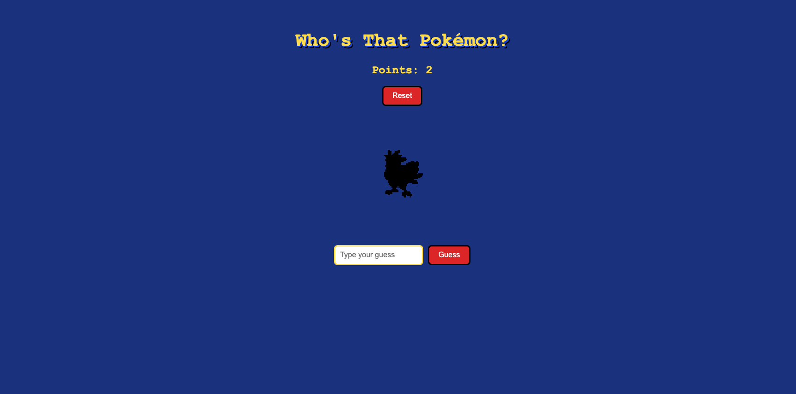

Who's That Pokémon?

demsingh30.github.io/Pokemon_Game	

A guessing game inspired by the classic "Who's That Pokémon?" reveal. A random first-generation Pokémon shows up as a black pixelated silhouette. Type your guess, and if you're right, the silhouette turns into the full sprite and you earn a point.

I built it while learning JavaScript API's, as a small project I actually wanted to play.

Add a screenshot here:  

<!-- Add a screenshot here:  -->
How to play
Look at the silhouette.
Type your guess and click Guess.
Right guess: the Pokémon is revealed and you get 1 point.
Wrong guess: you see "Try again!".
Your points are saved in your browser, so they're still there after a refresh. Click Reset to start over at 0.
Features
Picks a random Pokémon from the original 151 on every page load
Pixelated black silhouette that becomes a smooth sprite in a circle when revealed (CSS only; JavaScript just adds and removes one class)
Guess matching ignores capital letters and extra spaces
Points saved with localStorage, so they survive a refresh
Reset button for points
A "stamp" that stops the same Pokémon from earning a second point
Built with
HTML
CSS (filter, image-rendering, :not())
JavaScript (fetch, DOM manipulation, localStorage)
PokéAPI for the Pokémon data and sprites
Run it yourself
Download or clone this repo.
Open index.html in your browser. You'll need an internet connection for the Pokémon data.
Bugs I tracked down
The black square. I put a gradient background on the silhouette image, and the whole box turned black. The CSS filter applies to everything painted on the element, background included. I found it by unticking styles one at a time in DevTools, then moved the background to only apply when the hidden class is removed.
Free points. Clicking Guess twice on the same Pokémon gave two points. I fixed it by saving the Pokémon's number after paying a point, and checking that number before paying again. The saved number has to live outside the click handler, or it resets on every click.
What I learned
Fetching from an API and reading the response
Why storage returns text, and why it needs to become a number before adding to it
Where a variable lives (its scope) decides who can see it
A check only looks; a stamp writes (=== asks, = writes)
How to debug: read the Console, shrink the problem, change one thing, test
What's next
One try per Pokémon: reveal the answer on a wrong guess, then move on to the next one without reloading
Hint button
Pick which generations to play
Make it playable online
Credits

Pokémon and Pokémon character names are trademarks of Nintendo, Game Freak, and Creatures Inc. This is a fan project made for learning, with no commercial purpose. Data and sprites come from PokéAPI.

Built by demsingh30